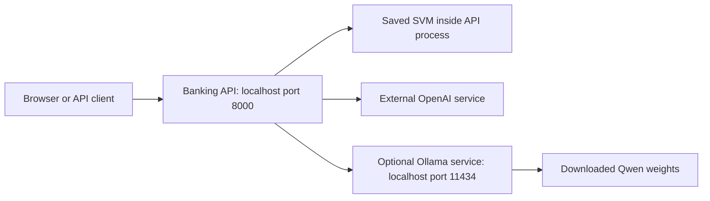

# Using the banking query API

**Goal:** start the local API and send banking queries from Swagger, Postman,
Bruno, curl or the example Python client.

## Start the local system

Locally live means the HTTP API is running and can perform inference. SVM and
Qwen compute on your machine; the OpenAI option sends messages to OpenAI.
The returned `route`/`review` actions do not forward messages or create review tasks.

### What needs to run?

| You want to use | Start yourself | What is loaded/called automatically |
| --- | --- | --- |
| SVM | Banking API with `make api` | Saved SVM artifact, once at API startup |
| Real OpenAI | Export `OPENAI_API_KEY`, then start the banking API in that same terminal | OpenAI service over HTTPS when an `openai` request arrives |
| Local Qwen | Ollama service, then banking API | Downloaded Qwen weights when a `local_llm` request arrives |
| All three | Ollama service plus banking API started with the OpenAI key | Backend selected by each request's `model` field |



The API and Ollama are separate programs. `make api` starts the banking API only.
Ollama runs natively in this setup; Docker is unnecessary. Jupyter, training, LangChain and
MCP are not required to serve predictions.

### 1. Prepare the project

Commands below assume Bash and the repository root. On this machine:

```bash
cd /home/prenassipaolo/Projects/banking_query_triage
uv sync --frozen
```

`uv` and `make` must be installed. `uv` manages the Python environment, so you do
not need to activate `.venv` manually. The fitted SVM is already shipped; starting
the API does not require training or running a notebook.

### 2. Start Ollama only if you want Qwen

First check whether an existing service is responding:

```bash
curl --fail http://127.0.0.1:11434/api/version
```

If it returns a version, the server is reachable. Reuse it only if it is already
configured with the required **8,192-token context** and the intended model cache;
the version endpoint does not verify either setting. If those settings are unknown,
stop the existing service using its own lifecycle instructions and start it with
the configuration below. A connection-refused error means you need to start it.
Start the native service below, with only one server on port 11434:

**Native Ollama — verified working on this machine.** In terminal A, run:

```bash
env OLLAMA_HOST=127.0.0.1:11434 \
    OLLAMA_MODELS="$PWD/.cache/ollama/models" \
    OLLAMA_CONTEXT_LENGTH=8192 \
    OLLAMA_NUM_PARALLEL=1 \
    OLLAMA_MAX_LOADED_MODELS=1 \
    OLLAMA_KEEP_ALIVE=30m \
    OLLAMA_NO_CLOUD=true \
    .cache/ollama/bin/ollama serve
```

Keep terminal A open. This project-local binary and its cache were installed on
this machine; they are excluded from Git. If the binary is absent, follow the
[native installation instructions](local_llms.md#4-native-ollama-installation)
first. A system-installed `ollama` can replace `.cache/ollama/bin/ollama` above.

In another terminal, verify the model is downloaded:

```bash
curl --fail http://127.0.0.1:11434/api/tags
```

Look for `qwen2.5:0.5b`. If it is missing, download it with the native CLI:

```bash
.cache/ollama/bin/ollama pull qwen2.5:0.5b
```

The configured Qwen model has already been downloaded on this machine. The native installation uses
`.cache/ollama/models`; repeated downloads are unnecessary.
`[local_llm].enabled` is already true in [serving.toml](../config/serving.toml).
Keep its `context_window_tokens` aligned with Ollama's 8,192-token context.

### 3. Start the banking API

In terminal B, from the repository root, choose the relevant startup command.

**SVM and/or Qwen, without real OpenAI calls:**

```bash
make api
```

**Real OpenAI calls, optionally alongside SVM and Qwen:** first set `[openai].mode`
to `"live"` in [serving.toml](../config/serving.toml) if you want missing credentials
to fail clearly instead of using the default auto-mode mock. Then run:

```bash
read -rsp "OpenAI API key: " OPENAI_API_KEY
printf '\n'
export OPENAI_API_KEY
make api
```

Paste the key at the hidden prompt. Keep it out of chat, TOML, request bodies and
Git. The key must be available to **this API process at startup**. Exporting it
in another terminal, or after the API has started, does not update the running API.
This project does not automatically load `.env` files.

Keep terminal B open. Wait for Uvicorn's **Application startup complete** message.
The API is at `http://127.0.0.1:8000`. If an old API process is already running,
stop it with Ctrl+C in its terminal before starting the replacement.

### 4. Verify and make a prediction

In terminal C, from the repository root:

```bash
curl --fail http://127.0.0.1:8000/health
curl --fail http://127.0.0.1:8000/ready
make predict
```

Expected: health reports `"status": "ok"`, readiness reports `"status": "ready"`,
and `make predict` prints SVM predictions. To check the optional live backends,
send the relevant request; each real OpenAI request uses your API billing:

```bash
uv run python examples/call_api.py --model openai
uv run python examples/call_api.py --model local_llm
```

| Response | What to confirm |
| --- | --- |
| OpenAI | `model` is `openai`, `mocked` is false, version has no `mock:` prefix |
| Qwen | `model` is `local_llm`, `model_version` is `qwen2.5:0.5b`, `mocked` is false |
| Either LLM | One prediction per input message, with `action: "review"` |

`GET /models` and `/ready?model=local_llm` report configuration; they do not probe
an upstream model. A successful prediction is the end-to-end check. Native Qwen
inference has been verified, but its measured classification accuracy is poor;
see the [comparison notebook](../notebooks/model_comparison.ipynb).

For a browser interface, open **[Swagger UI](http://127.0.0.1:8000/docs)**, expand
**POST /predict**, click **Try it out**, choose the `model` in the JSON and execute.
The request client/browser does not need the OpenAI key; the server holds it.

### Stop, restart and the next day

| Service | Stop it | Start it again |
| --- | --- | --- |
| Banking API | Ctrl+C in terminal B | Export the key if using OpenAI, then `make api` |
| Foreground native Ollama | Ctrl+C in terminal A | Native command from step 2 |
| Detached native Ollama | Follow the [PID/process instructions](local_llms.md#native-process-use-the-installed-project-local-binary) | Native command from step 2 |

`ollama stop qwen2.5:0.5b` only unloads the model; it does not shut down Ollama.
Stopping these services preserves downloaded weights and the fitted SVM artifact.
After a reboot, start the services you need again; this project does not install
automatic system startup. A new terminal needs its own key export for real OpenAI
calls. Restart the banking API after changing its key or serving configuration.

## Copy and paste into Postman or Bruno

Create a request with these settings:

| Setting | Value |
| --- | --- |
| Method | `POST` |
| URL | `http://127.0.0.1:8000/predict` |
| Header | `Content-Type: application/json` |
| Body | JSON; choose **raw → JSON** in Postman or **JSON** in Bruno |

Paste this into the request body and click **Send**:

```json
{
  "messages": [
    "My card has not arrived yet",
    "I do not recognise this cash withdrawal",
    "I have a problem"
  ]
}
```

For a single query, keep a list with one message:

```json
{
  "messages": ["My card has not arrived yet"]
}
```

The same example payload is saved in [examples/predict.json](../examples/predict.json).

## Select the model

Add `model` to any prediction request; omitting it selects `svm`:

```json
{
  "model": "openai",
  "messages": ["My card has not arrived yet"]
}
```

| `model` | Behavior |
| --- | --- |
| `svm` | Loaded TF-IDF/SVM artifact; calibrated confidence and existing route/review threshold |
| `openai` | OpenAI Responses API using the model configured in `[openai]`, initially `gpt-6-luna` |
| `local_llm` | Qwen through a separate schema-capable server; enabled in the supplied TOML |

Use `GET /models` to inspect all backends, `GET /model?model=openai` for one,
or `GET /ready?model=openai` to check configuration readiness. These endpoints
do not probe upstream availability. Unknown model names return HTTP 422.

The default OpenAI `mode = "auto"` uses `OPENAI_API_KEY` when present at startup.
Without a key it reuses the SVM as a deterministic mock: responses include
`"mocked": true` and `"model_version": "mock:gpt-6-luna"`. This tests API wiring,
not LLM quality. `mode = "mock"` always stays offline; `mode = "live"` returns
HTTP 503 if the key is missing. A failed live request returns HTTP 502 and never
falls back to mock.

To use a real OpenAI call, set `OPENAI_API_KEY` in the server environment and
restart `make api`. Keep the key out of TOML and request bodies. Change
`[openai].model` in [serving.toml](../config/serving.toml) to another model that
supports Responses, structured outputs and `reasoning.effort = "none"`.
[Luna model documentation](https://developers.openai.com/api/docs/models/gpt-6-luna)
and [structured output documentation](https://developers.openai.com/api/docs/guides/structured-outputs)
describe the provider interface.

LLM confidence is a self-reported estimate, not a calibrated probability. All
LLM and mock predictions return `action: "review"` and `review_threshold: null`.
`confidence_kind` in model metadata distinguishes `self_reported`,
`svm_mock_probability` and the SVM's `calibrated_probability`.

For Qwen, follow [step 2 of the startup sequence](#2-start-ollama-only-if-you-want-qwen)
to start the separate inference service. See the [local LLM guide](local_llms.md)
for general chat, other applications and production deployment.

`[local_llm].enabled` is true in the supplied TOML; restart the API after changes.
The defaults use `http://127.0.0.1:11434/v1` and `qwen2.5:0.5b`; change both for
another server/model. `BQT_LOCAL_LLM_API_KEY` optionally supplies a separate local
server credential. The OpenAI key is never sent to the local server. No model
download or provider call happens at API startup. The runtime context must match
`context_window_tokens` (8,192). The API reserves output/template space and rejects
oversized local prompts with 422. The [call-flow guide](call_flows.md) explains
the budget, prompts and batching; the [comparison notebook](../notebooks/model_comparison.ipynb)
contains the measured train/test pilot.

One request can contain several messages, making one provider call for the list.
See [grouped synchronous calls](call_flows.md#multiple-messages-and-batching)
for processing a dataset without one request per message.

## Understand the response

The single-query request above returns this response with the supplied model
(confidence shown rounded here):

```json
{
  "model": "svm",
  "model_version": "tfidf_svm_v1",
  "mocked": false,
  "predictions": [
    {
      "category": "card_arrival",
      "confidence": 0.96827,
      "action": "route"
    }
  ]
}
```

| Field | Meaning |
| --- | --- |
| `model` | Selected backend: `svm`, `openai` or `local_llm` |
| `model_version` | Artifact version or provider model identifier; `mock:` prefix for mock mode |
| `mocked` | Whether a mock supplied the predictions |
| `category` | Predicted banking intent; `/model` lists the allowed categories |
| `confidence` | Category confidence, between 0 and 1; semantics depend on the backend |
| `action` | SVM: `route` when confidence meets its threshold; otherwise `review`. LLM/mock: always `review` |

Results follow the order of the input messages. The supplied model uses a
threshold of **0.7**, including equality. Actions are simulated: the API returns a
decision without forwarding messages or creating a review task. Confidence does
not guarantee correctness, and this model has no separate out-of-domain detector.

## Try it in Swagger

1. Start the API, then open [Swagger UI](http://127.0.0.1:8000/docs).
2. Expand **POST /predict** under **Predictions**.
3. Click **Try it out**, paste either JSON payload above, and click **Execute**.
4. Read the response status and JSON under **Server response**.

[ReDoc](http://127.0.0.1:8000/redoc) provides a reading view. The
[OpenAPI schema](http://127.0.0.1:8000/openapi.json) can also be imported into API
clients that support OpenAPI URL import. These local links work while the server
is running.

## Use curl or Python

In a second terminal, from the repository root:

```bash
curl --request POST http://127.0.0.1:8000/predict \
  --header 'Content-Type: application/json' \
  --data-binary @examples/predict.json
```

Or use the supplied Python client through Make:

```bash
make predict
uv run python examples/call_api.py --payload path/to/my_payload.json
```

The client prints the JSON response or an HTTP/connection error. This is a manual
smoke check: it does not assert the predicted category or response structure.
`make test` runs the automated tests. Make targets are fixed shortcuts; use the
underlying CLI directly when supplying options.

## Endpoints and request limits

| Method | Path | Purpose |
| --- | --- | --- |
| `POST` | `/predict` | Predict one or more messages |
| `GET` | `/health` | Check whether the application responds |
| `GET` | `/ready` | Check whether the model is loaded; includes its version |
| `GET` | `/model` | Inspect the version, categories, review threshold and input limits |
| `GET` | `/models` | List backend configuration, availability, confidence semantics and mock status |

With the default [serving configuration](../config/serving.toml):

- Send **1–32 messages** per request, with at most **4,096 characters per message**.
- Each message must be a nonempty string; whitespace-only messages are rejected.
- The body must contain `messages` as a JSON list; `model` is optional. Other fields are rejected.

`GET /model` reports the actual limits of the running server. The model loads
once at startup; requests run inference without training.

## Change the port or configuration

```bash
uv run banking-query-triage --port 8001
```

Use `http://127.0.0.1:8001/predict` in your client, or run:

```bash
uv run python examples/call_api.py --url http://127.0.0.1:8001/predict
```

Swagger is then at `http://127.0.0.1:8001/docs`.

```bash
uv run banking-query-triage --config path/to/serving.toml
```

The TOML file controls the artifact directory, request limits and provider settings. Relative artifact
paths resolve against the TOML file. The review threshold belongs to the model
manifest and cannot be changed in a prediction request. Restart the server after
changing its configuration.

Keep model settings in `config/serving.toml`, credentials in environment variables,
and example request bodies in `examples/predict.json`. Host and port are server CLI
options; they do not need another configuration file for occasional overrides.

## Troubleshooting

| Symptom | What to check |
| --- | --- |
| Connection refused | Start `make api`, wait for startup to complete, and check the port |
| OpenAI response says `mocked: true` | Export the key in the API terminal before startup and restart; use `[openai].mode = "live"` to fail clearly when the key is missing |
| Native Ollama command is missing | The ignored project-local binary is not part of a fresh clone; follow the linked native installation guide |
| HTTP 422 | Check JSON syntax, the `messages` list, nonblank strings and request limits; response `detail` identifies validation errors |
| HTTP 503 | The model is not ready, local LLM is disabled, or live OpenAI has no key; inspect `/models` and configuration |
| HTTP 502 | Provider failed, timed out, refused or returned invalid/truncated output; check the provider and configured token limit |
| Server fails at startup | Check the configured model directory and manifest; use `uv sync --frozen` to reproduce the dependency environment |
| Port already in use | Stop the process using it or select another port |

[Repository overview](../README.md) · [Code map](repository_guide.md)
