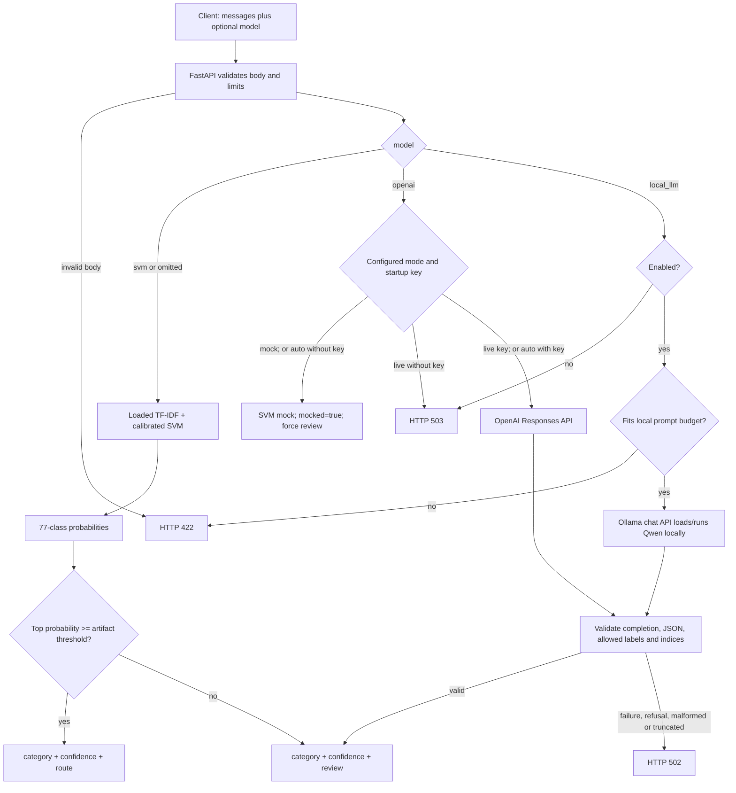
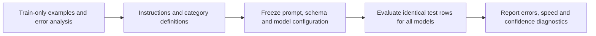

# Model calls, prompts and comparison protocol

**Goal:** trace every banking API route and understand what the model comparison measures.

[API commands](api_usage.md) · [Local LLM engineering guide](local_llms.md) ·
[Comparison notebook](../notebooks/model_comparison.ipynb)

## The three choices

| Request `model` | Computation | Actual model identity | Requires another service? |
| --- | --- | --- | --- |
| `svm` (default) | Local sklearn pipeline inside FastAPI | `tfidf_svm_v1` artifact | No |
| `openai` | HTTPS Responses request, or explicit offline mock | Configured OpenAI ID; `mock:` prefix in mock mode | OpenAI API; key in server environment |
| `local_llm` | HTTP chat completion with constrained JSON | `qwen2.5:0.5b` | Yes: Ollama, normally on port 11434 |

`model` selects a backend; `model_version` identifies its configured artifact/model.
They answer different questions. A provider alias/tag can change: the comparison
saves prompt fingerprints and model metadata, and local runtime evidence records
the actual Qwen digest. An alias alone does not guarantee reproducibility.



The live OpenAI route does not ask SVM to classify first. The SVM object currently
supplies the common label vocabulary and implements the offline mock. A provider
failure never silently falls back to SVM. There is no SVM-to-LLM cascade, ensemble,
tool execution, customer forwarding or persistent review queue in the application.

`GET /models` lists configured backends and confidence semantics. `GET /ready`
checks configuration, not whether OpenAI/Ollama will successfully answer. A stopped
Ollama service can therefore be configured as available but fail prediction with 502.
Swagger is at `http://127.0.0.1:8000/docs` while `make api` is running.

## Where prompt engineering lives

The single source is [`src/banking_query_triage/llm.py`](../src/banking_query_triage/llm.py):

| Function | Purpose |
| --- | --- |
| `classification_prompt(labels)` | Zero-shot instructions shared by both LLMs |
| `classification_schema(labels)` | Fields, types and enum of allowed categories |
| `openai_request(...)` | Responses body for one grouped synchronous call |
| `parse_classifications(...)` | Enforce labels and exactly-once indices; restore input order |

The prompt supplies all 77 category names, treats input messages as untrusted data,
requests JSON only, and asks for one indexed result per message. OpenAI uses
`reasoning.effort="none"`; local Qwen uses `temperature=0`. Both use the label enum
in the generation schema and both undergo application-side validation. Structured
outputs constrain representation, not semantic correctness.
[OpenAI structured outputs](https://developers.openai.com/api/docs/guides/structured-outputs)

The current prompt is **zero-shot**: no examples, retrieval, category definitions,
fine-tuning, prompt search or hidden training step. `PROMPT_VERSION` names it;
`prompt_sha256` hashes its exact instructions and schema. Both are exposed through
model metadata and recorded by the comparison. When changing the prompt, advance
its version and rerun a train-only development comparison before inspecting test
results. The hash catches even an accidental unversioned change.

The current prompt deliberately forces a nearest category for unrelated input.
Every LLM result then receives `action="review"` from application code, irrespective
of reported confidence. That is **not out-of-domain detection**. A future abstention
contract should allow `category=null` and a finite reason such as `out_of_scope` or
`ambiguous`. This comparison does not silently introduce that behavior.



## Multiple messages and batching

### Synchronous grouping: a result now

One request can contain several messages; the service makes **one** provider call
for the list. Its response contains one prediction per message, in input order:

```json
{
  "model": "local_llm",
  "messages": ["My card has not arrived", "How do I change my PIN?"]
}
```

The API accepts at most 32 messages and 4,096 characters per message by default.
For local Qwen, a separate conservative UTF-8 prompt-byte budget also applies.
With an 8,192-token runtime context, 2,048 output-token limit and 256-token template
reserve, the budget is 5,888 bytes, including instructions and serialized messages.
For Qwen's byte-level tokenizer this bounds input tokens conservatively. Configure
the runtime context to match `context_window_tokens`; another model/chat template
needs its own validated reserve. An oversized local batch returns 422 before inference,
rather than relying on Ollama's context truncation.

Grouping saves repeated prompt and network overhead. It does not eliminate tokens
for the individual messages/results or earn the asynchronous Batch discount.
Larger groups also mean longer shared latency, greater context/output demands, and
more rows affected by a malformed response. The comparison starts with eight
messages per call for all three models. It sends groups sequentially to avoid
mixing concurrency effects with model quality.

### Removed asynchronous Batch workflow

The supported path above groups messages in one synchronous call. The separate
prepare/submit/status/collect CLI was never exercised against a live asynchronous
job and has been removed. No provider failure was established; the workflow was
unverified. [Evidence and retry criteria](architecture_decisions.md#asynchronous-openai-batch)
remain for a future end-to-end attempt. Notebook execution submits no asynchronous job.

## What the notebook measures

[`notebooks/model_comparison.ipynb`](../notebooks/model_comparison.ipynb) defaults to
reading saved results. Settings live in [`config/model_comparison.toml`](../config/model_comparison.toml).

```bash
# Agreed pilot: 2 messages per category per split, identical rows for all models.
uv run python -m notebooks.model_comparison
# All 10,003 train and 3,080 test rows; reuse matching completed pilot evidence.
uv run python -m notebooks.model_comparison --full
# Explicitly retry recorded failures; successful requests are reused.
uv run python -m notebooks.model_comparison --retry-failed
```

The SVM is already fitted on the train dataset. Its train scores are
**resubstitution scores**, not generalization estimates. The pretrained LLMs are
not fitted on this banking dataset; their train-split results are evaluation on
those messages. We cannot establish whether their pretraining included BANKING77.
The existing test benchmark has also been inspected previously. Neither pilot
results nor this historical test set are a fresh untouched final holdout.

| Measurement | Interpretation |
| --- | --- |
| Accuracy; macro precision, recall and F1 | Same selected rows and 77-label vocabulary; failed outputs count as wrong |
| Valid-only accuracy; failure rate | Exposes how output failures affect service quality; never hide them by reporting valid-only accuracy alone |
| Route coverage; routed accuracy | SVM demonstration policy; LLM coverage is zero and routed accuracy is undefined |
| Mean confidence | Calibrated SVM top probability versus LLM self-reported score; different semantics |
| Confidence-correctness Brier; ten-bin ECE | Compare top-label score to the binary event "prediction is correct" on valid outputs |
| Batch latency p50/p95 | End-to-end HTTP wall time for an entire group, including provider and validation; includes matching failed attempts and explicit retries |
| Amortized ms/message; messages/second | Total matching request time divided by unique evaluated messages; includes retry overhead, not interactive latency |

For confidence `c_i` and correctness `z_i`, the diagnostic Brier score is
`mean((c_i - z_i)^2)`. It is not the multiclass Brier score used in the existing
probability-model experiments. LLM self-reports do not provide the full vector
`P(class=k)` required for multiclass log loss, ROC AUC or multiclass Brier. Those
metrics are omitted from this three-way comparison. We do not distribute `1-c`
uniformly across the other classes or treat token logprobs as class probabilities.

The pilot contains only two test examples per class: it is useful for plumbing and
an initial comparison, with high sampling uncertainty. It cannot justify deployment,
choose an automatic routing threshold, or establish out-of-domain behavior.

Each request is checkpointed in `artifacts/model_comparison/requests.jsonl` with
row IDs, signature, predictions/errors and elapsed time. Raw messages and secrets
are not copied into that file. Signatures bind evidence to dataset hashes, backend
metadata, prompt hash, output limits and batch settings. Full runs reuse matching
rows; changing any of those signatures requires new calls. Failed requests are
recorded and only retried explicitly. Run one writer at a time.

A fully cached model can reuse its recorded real metadata even if its credentials
are no longer available, provided the selected rows and configured model/prompt
identity still match. Backends needing new requests must be live; mock predictions
are never substituted. `reused_completed_backends` records this choice in the manifest.

The runner stops after three consecutive failures and saves partial results.
`failure_rate` describes each row's latest outcome; `request_failure_rate` describes
all matching attempts. Request counts, total request time and message executions
include superseded failures/retries. A reused batch intersecting a selected subset
contributes its whole historical request time. The saved-results notebook checks
manifest status, CSV hashes, dataset fingerprints and the current prompt/schema
before joining original text or displaying the current prompt.

The first measured batch is retained; the model may already be warm from a smoke
check. Download/startup time is excluded. The local runtime record identifies CPU,
runtime version, model digest and context configuration. HTTP timings cannot isolate
provider queueing from inference. Use repeated controlled runs, explicit warm/cold
conditions and higher request counts before interpreting tail latency.
