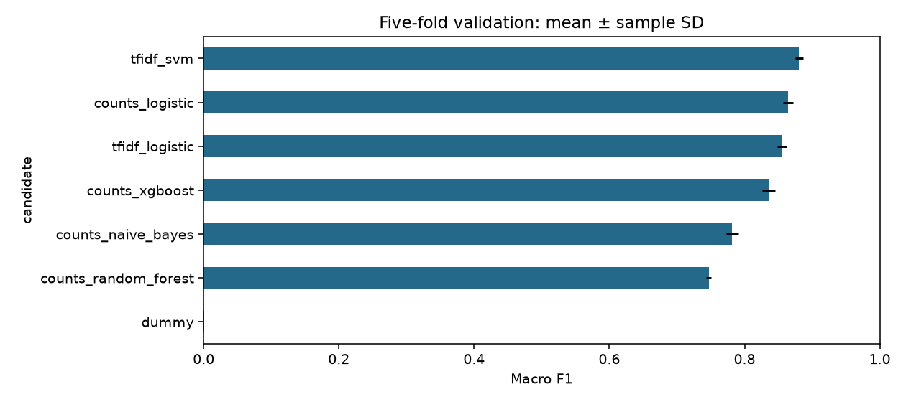
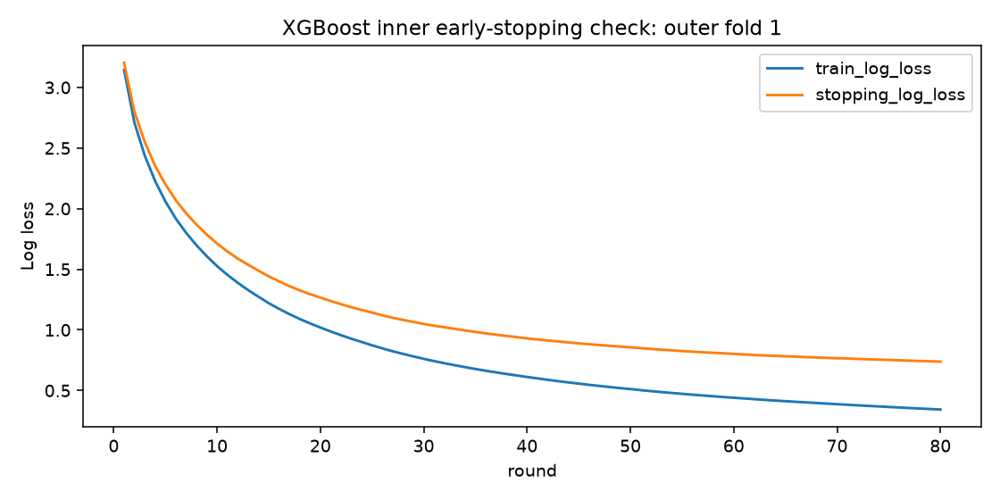

# Five-fold model comparison

**Goal:** learn a few interpretable techniques, compare on five folds, then fit on all training data.

**Selected:** single-word TF-IDF → linear SVM C=1 → learned temperature/softmax calibration.

| Candidate | CV accuracy % ± SD | CV macro F1 % ± SD | CV log loss ± SD | Test accuracy | Test log loss |
| --- | ---: | ---: | ---: | ---: | ---: |
| tfidf_svm | 88.33 ± 0.58 | 88.07 ± 0.54 | 0.472 ± 0.017 | 89.42% | 0.422 |
| counts_logistic | 86.60 ± 0.74 | 86.45 ± 0.73 | 0.598 ± 0.015 | 88.86% | 0.518 |
| tfidf_logistic | 86.01 ± 0.75 | 85.55 ± 0.69 | 1.089 ± 0.014 | 87.89% | 0.959 |
| counts_xgboost | 83.78 ± 0.97 | 83.55 ± 0.96 | 0.691 ± 0.021 | 85.52% | 0.620 |
| counts_naive_bayes | 80.65 ± 1.00 | 78.18 ± 0.93 | 0.714 ± 0.027 | 81.36% | 0.716 |
| counts_random_forest | 76.47 ± 0.48 | 74.69 ± 0.39 | 2.056 ± 0.025 | 77.14% | 2.060 |
| dummy | 1.87 ± 0.03 | 0.05 ± 0.00 | 4.309 ± 0.000 | 1.30% | 4.384 |

- Seven fixed candidates; no word pairs, character sequences, or parameter grid.
- Selection uses mean **validation macro F1**, then accuracy. All candidates are refitted on all **10,003** training rows and tested only after selection is frozen.
- Test is a **previously inspected benchmark**, not a fresh untouched holdout. New test results did not choose the winner.
- These are representative settings, not the best achievable version of each family. Random forest uses depth/leaf limits; XGBoost has an 80-round budget. Lower scores do not prove those families are intrinsically worse.



## Read all the values in one place

- **[results.csv](../artifacts/cv_experiments/results.csv):** one row per candidate; all train/validation means and standard deviations, full-training/test metrics, errors, timings, feature counts and boosting rounds.
- **[results.json](../artifacts/cv_experiments/results.json):** same summary plus individual folds, input configuration, actual component settings, versions, source/data fingerprints, pooled out-of-fold metrics and learning curves.
- **[Notebook](../notebooks/experiments.ipynb):** `results.comparison()`, `results.summary()`, `results.folds()`, `results.learning_curves()`, `results.errors()`.
- All quality metrics are fractions unless a table explicitly shows percent. Standard deviation is the sample SD across five fold scores (`ddof=1`), not a confidence interval.
- Full-training/test SD is **blank/null: not estimated**. Those each use one final fit and one fixed dataset. It would be misleading to fill zero.

## Selected model

| Measurement | CV training mean ± SD | CV validation mean ± SD | Final full training | Test |
| --- | ---: | ---: | ---: | ---: |
| Accuracy | 98.37% ± 0.12 pp | 88.33% ± 0.58 pp | 98.05% | 89.42% |
| Macro F1 | 98.35% ± 0.10 pp | 88.07% ± 0.54 pp | 98.02% | 89.43% |
| Log loss | 0.066 ± 0.003 | 0.472 ± 0.017 | 0.073 | 0.422 |
| Macro ROC-AUC | 0.9999 | 0.9966 | 0.9999 | 0.9968 |

- Final vocabulary: **1,461 single words**. Test errors: **326 / 3080**.
- Fixed demonstration threshold **0.7**, with no threshold search: test coverage **87.21%**, accepted accuracy **95.50%**. These are not customer-safety guarantees.
- Seven conservative train/test overlaps remain; excluding them gives **89.39%** accuracy. Raw rows/labels remain unchanged.
- Multiclass Brier score is also recorded, on the mean sum-of-squares scale [0, 2]. Lower log loss/Brier is better; ROC-AUC evaluates ranking rather than top-category correctness.

## Fitting policies

| Model | Policy |
| --- | --- |
| Dummy / naive Bayes | Ordinary fit; no epoch-based early stopping |
| Logistic regression / SVM | Fit to convergence with regularization; record train/validation metrics |
| Random forest | Fixed tree count/depth/leaf limits; no boosting-style early stopping |
| XGBoost | Inner training/stopping split within each outer training fold; monitor log loss and error, stop on log loss; refit all outer-training rows using chosen rounds |

- Outer validation never determines stopping directly. Final XGBoost rounds = median of the five training-only choices.
- **All five XGBoost fits reached the 80-round cap.** Patience did not trigger. More boosting budget might change its result; this is intentionally not a tuning exercise.
- SVM probability calibration also uses training-only grouped folds, fitting the complete preprocessing/vectorizer/model pipeline separately in each inner fold.



## Pipeline and extension points

```text
BasePreprocessor → BaseFeatureExtractor → BaseMlModel
    → TextPipeline + BaseFitPolicy + BaseEvaluator → Experiment
    → ExperimentRunner: outer CV → frozen choice → full-data refits → benchmark
    → ExperimentResults
```

- Abstract contracts have separate concrete implementations. Native-first model/vectorizer subclasses retain constructors, parameters, cloning, tags, fitting and prediction.
- `StandardFit`, `CalibratedFit`, and `EarlyStoppingFit` orchestrate pipeline fitting. Raw SVM does not promise probabilities; its calibrated fitted pipeline does.
- Compose objects directly, or resolve TOML names through the small registry. `ExperimentRunner(config, experiments=[...])` accepts explicit specifications. `ClassificationEvaluator(extra_metrics=...)` adds metric functions.
- Every fit clones the component specification. Classes live under `notebooks/utils/`, ready for later promotion into `src/`; original EDA/helpers remain preserved.

## Run and review

```bash
uv run python -m notebooks.experiments
make test
```

- `make experiments` was removed: it was only an optional alias. The notebook has an explicit `RUN_EXPERIMENTS` switch, default false.
- CLI reruns overwrite current artifacts; notebook Run All refreshes saved-result views/charts. The narrative report is a snapshot and needs checking after configuration changes.
- Focused tests cover abstract contracts, native estimator compatibility, reusable specifications, probability validation, calibration/stopping boundaries and freezing selection before test labels. Source fingerprints and save/load checks accompany the current run.
- [Actual architectural changes](architecture_decisions.md).
