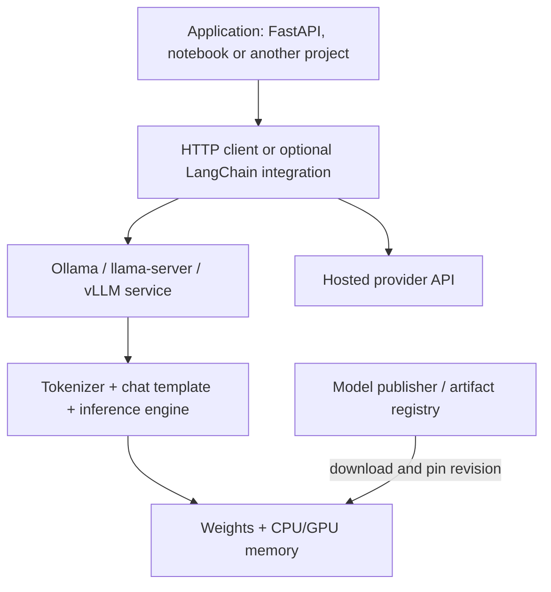
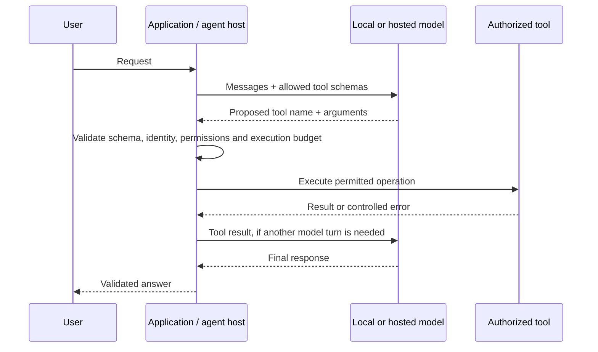
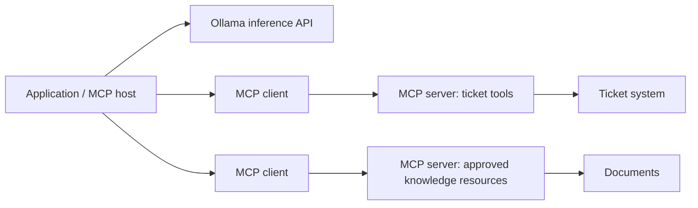
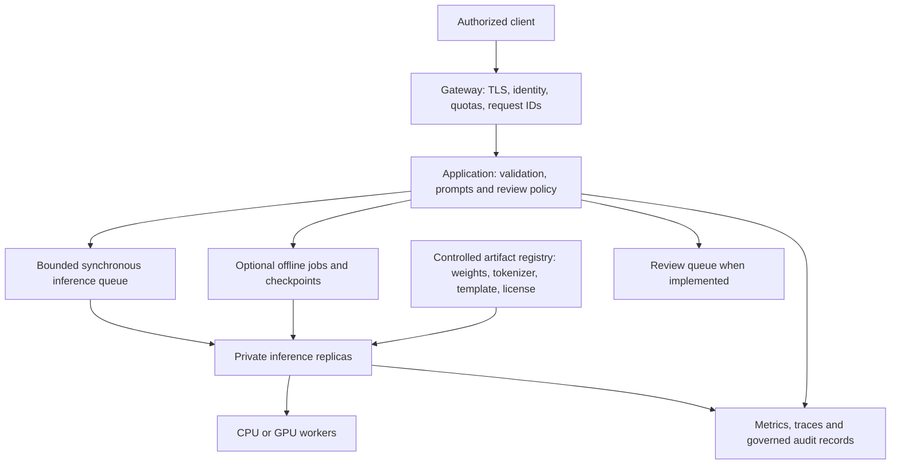

# Local open-weight LLMs: from a laptop to a company service

**Goal:** understand the components, operate a reusable local model, and design a
production service from measured requirements.

[Banking request flows and prompts](call_flows.md) · [API usage](api_usage.md) ·
[Three-model comparison](../notebooks/model_comparison.ipynb)

## 1. A model is an artifact; inference is a running computation

An LLM contains learned numerical weights. A causal language model predicts the
next token conditional on preceding tokens. A runtime loads those weights,
tokenizes input, executes tensor operations, samples or selects output tokens,
and decodes them into text. Installing a Python client does not load a model;
downloading weights does not start a server; starting a server does not necessarily
load the weights into memory until the first inference request.

An **open-weight** release lets you obtain the weights under its license. That
does not imply that the training data, complete training recipe or all commercial
rights are unrestricted. Inspect the exact model variant, license and derivative
conditions. A model can be open-weight and still be served by a paid external API.
"Local" describes where inference runs, not who created the weights.

Qwen is a model family from the Qwen team at Alibaba. This project selects the
small instruction-tuned Qwen2.5 0.5B variant via Ollama's `qwen2.5:0.5b` tag.
The upstream model card lists 0.49B parameters, a 32,768-token context and Apache
2.0 licensing. The actual serving context can be configured smaller than the model's
maximum. [Qwen model card](https://huggingface.co/Qwen/Qwen2.5-0.5B-Instruct)

The downloaded Ollama package is about 398 MB and uses `Q4_K_M` quantization.
That is an artifact size, not a RAM reservation or an accuracy result.
[Ollama model package](https://ollama.com/library/qwen2.5:0.5b)

## 2. Who does what: vendors, programs, libraries and protocols

| Component | Layer and responsibility | Does it run model tensor computation? | Used here? |
| --- | --- | --- | --- |
| Qwen / Alibaba | Model producer; weights, tokenizer, architecture and instruction tuning | Supplies the artifact, not our running service | Qwen weights |
| OpenAI | Hosted model provider; operates external inference and APIs | Yes, on provider infrastructure | Hosted comparison backend |
| Hugging Face Hub | Artifact/model-card distribution and versioning; also offers hosted products | A Hub download alone does not | Upstream reference |
| PyTorch | Tensor/autograd framework supporting model execution and training | Yes | Not needed for our Ollama path |
| Transformers | Python model/tokenizer implementations, generation and training integration | Uses a tensor backend such as PyTorch | Alternative for research/fine-tuning |
| llama.cpp | C/C++ inference runtime with quantization, hardware backends and `llama-server` | Yes | Alternative lightweight runtime |
| Ollama | Model download/packaging, templates, runtime lifecycle, CLI and HTTP service | Coordinates inference engines | Local service in this project |
| vLLM | Inference/serving engine aimed at throughput, scheduling and efficient accelerator use | Yes | Production option to evaluate |
| `openai` Python SDK | HTTP client and API types; can target compatible local endpoints | No | Client for OpenAI and Ollama |
| FastAPI / Uvicorn | Application HTTP interface and server: validation, routing and policy | Calls a backend | Banking API |
| Docker / Compose | Package and manage processes, filesystems, networking and volumes | Does not itself accelerate inference | General packaging option; project startup removed |
| LangChain | Model/tool integrations and application/agent composition | Calls a model runtime/provider | Not required or installed here |
| LangGraph | Stateful workflow/agent orchestration, including durable execution patterns | Calls model/tool components | Not required here |
| LangSmith | Tracing/evaluation product associated with the LangChain ecosystem | Observes application behavior | Optional; check data handling before adoption |
| MCP | Protocol through which an application exchanges tools/context with servers | No | Explained below; not implemented in this classifier |

For example, installing `langchain-ollama` adds an application integration. You
still need Ollama running and the selected model downloaded. Using the OpenAI SDK
against `http://127.0.0.1:11434/v1` does not send those requests to OpenAI.
[LangChain Ollama integration](https://docs.langchain.com/oss/python/integrations/chat/ollama)

LangChain and Ollama solve different problems and can be used together. Our
single classification request needs a prompt, an HTTP client and validation;
adding an agent framework would not remove that work. Consider LangChain when
its integrations reduce repeated application code; consider LangGraph when a
workflow needs state, branching, interruption and recovery. A plain Python
function is often enough for a fixed request path.
[LangChain overview](https://docs.langchain.com/oss/python/langchain/overview),
[LangGraph overview](https://docs.langchain.com/oss/python/langgraph/overview)



A shared HTTP shape is useful, but "OpenAI-compatible" is not a universal feature
guarantee. Check endpoint, schema subset, tool-call format, usage fields, reasoning
options, error handling and streaming for the exact runtime/model combination.
[Ollama compatibility](https://docs.ollama.com/api/openai-compatibility)

## 3. Weights, quantization, context and hardware

For `P` parameters stored at `b` bits each, the idealized weight storage is:

```text
weight bytes ≈ P × b / 8
resident memory ≈ weights + KV cache + runtime buffers + temporary activations
```

Thus 0.5B parameters at four bits is roughly 250 MB before mixed precision,
quantization metadata and packaging. `Q4_K_M` is not literally four bits for every
tensor. BF16/FP16 weights use approximately two bytes per parameter. Quantization
reduces storage/bandwidth requirements and can change both speed and quality;
kernel support and hardware determine the actual effect. Benchmark the quantized
artifact you intend to deploy, not only the original full-precision model.

During generation, the attention **KV cache** stores keys/values for earlier
tokens. A useful first approximation is:

```text
KV bytes ≈ 2 × layers × sequence tokens × KV heads × head dimension
           × bytes per cache element × concurrent sequences
```

Grouped-query attention can use fewer KV heads than query heads. Cache quantization,
prefix sharing and engine scheduling change the real memory behavior. Long context
and high concurrency can dominate a model that looked small on disk. Advertised
maximum context is a capability bound, not a sensible default for every request.

Inference has two different phases:

| Phase | Work | Practical consequence |
| --- | --- | --- |
| Prefill | Process the prompt and build its cache | Long prompts and repeated categories cost input work |
| Decode | Generate successive output tokens | Output length strongly affects response time |
| Cold load | Read weights and initialize the engine | First inference after eviction can be slower |

A CPU can run this small Qwen model. A GPU can improve throughput if supported,
but also adds driver, memory and deployment constraints. Do not infer latency
from parameter count alone. On a memory-constrained laptop, swapping can erase
any expected gain. Record CPU/GPU, memory, context, quantization, threads,
concurrency and warm/cold state alongside measurements.

The llama.cpp project provides GGUF-oriented inference and multiple hardware
backends. vLLM provides mechanisms such as continuous batching, paged KV memory
and prefix caching; evaluate them when concurrent accelerator workloads justify
the operational complexity.
[llama.cpp](https://github.com/ggml-org/llama.cpp),
[vLLM](https://docs.vllm.ai/en/latest/index.html)

## 4. Native Ollama installation

**This session uses native Ollama 0.40.11, not a running Docker container.** The
Docker image transfer repeatedly failed. A checksum-verified official native archive
was downloaded into the ignored `.cache/ollama/` directory; CPU libraries and the
binary were extracted, and Qwen was pulled into `.cache/ollama/models/`.

The service listens on `127.0.0.1:11434`, with cloud features disabled. This session
leaves a detached native process, with its PID in `.cache/ollama/server.pid` and
logs in `.cache/ollama/server.log`. It is not an installed system service and does
not start automatically after a reboot. `docker ps` does not show native processes.
Ollama does not require Docker. The failed project Docker startup path was removed;
[retry notes](architecture_decisions.md#ollama-docker-startup) preserve its evidence.

### Native process: use the installed project-local binary

The current server is already running. To start a foreground replacement after
stopping it, run from the repository root in a terminal kept open:

```bash
export OLLAMA_HOST=127.0.0.1:11434
export OLLAMA_MODELS="$PWD/.cache/ollama/models"
export OLLAMA_CONTEXT_LENGTH=8192
export OLLAMA_NUM_PARALLEL=1
export OLLAMA_MAX_LOADED_MODELS=1
export OLLAMA_KEEP_ALIVE=30m
export OLLAMA_NO_CLOUD=true
.cache/ollama/bin/ollama serve
```

Start only one service on that port. In another terminal:

```bash
.cache/ollama/bin/ollama list
.cache/ollama/bin/ollama ps
curl http://127.0.0.1:11434/api/version
curl http://127.0.0.1:11434/api/tags
```

`list`/`api/tags` show downloaded packages. `ps` shows models currently resident
in memory, which can be empty while the service is healthy. `api/version` checks
the HTTP service, not whether inference will succeed. Stop a foreground service
with Ctrl+C. For the detached process, inspect `ps -p "$(cat .cache/ollama/server.pid)" -o pid,args`
and send `kill -TERM PID` to the Ollama server PID shown there.
`ollama stop qwen2.5:0.5b` unloads the model; it does not stop the server.

For a new native installation, use [official platform downloads](https://ollama.com/download)
and the [Linux instructions](https://docs.ollama.com/linux). A system installation
may provide an `ollama` command and a managed service; then replace the project-local
binary path above with `ollama` and configure its service environment. Do not run a
second manual server if the system service already owns port 11434.

## 5. Use Ollama for tasks outside banking

The server is reusable. The banking prompt is supplied by our Python service on
each banking request; it is not baked into Qwen or Ollama. Another project can
call the same runtime with its own messages, system instructions and model tag.

### Interactive CLI

```bash
.cache/ollama/bin/ollama run qwen2.5:0.5b
```

Ask a normal question at the prompt; `/bye` ends the CLI conversation without
stopping the server. From another directory use the absolute binary path, or add
the binary directory to that terminal's `PATH`. Native Ollama users can use
`ollama run ...` directly. `OLLAMA_HOST` selects another server address if needed.

### Native HTTP API: general chat, no banking categories

```bash
curl http://127.0.0.1:11434/api/chat \
  --header 'Content-Type: application/json' \
  --data '{
    "model": "qwen2.5:0.5b",
    "messages": [
      {"role": "system", "content": "Explain concepts clearly and briefly."},
      {"role": "user", "content": "What is a database index?"}
    ],
    "stream": false,
    "options": {"temperature": 0, "num_predict": 150}
  }'
```

Use `stream=false` for a single JSON response. With streaming enabled, the native
endpoint returns multiple incremental JSON objects; an OpenAI-compatible streaming
endpoint uses its own event format. Parse the actual protocol rather than treating
the whole byte stream as one JSON document. Chat history is supplied by the client
in `messages`; this HTTP example does not create durable conversational memory.

### Python using the SDK already installed in this repository

```python
from openai import OpenAI

with OpenAI(
    base_url="http://127.0.0.1:11434/v1",
    api_key="local",  # Non-secret placeholder; stock local Ollama ignores it.
    timeout=120,
    max_retries=0,
) as client:
    reply = client.chat.completions.create(
        model="qwen2.5:0.5b",
        messages=[
            {"role": "user", "content": "Suggest three names for a gardening app."}
        ],
        temperature=0.5,
        max_tokens=150,
    )
    print(reply.choices[0].message.content)
```

Another Python project needs its own client dependency/environment, but can reuse
the same server and downloaded model. It does not need this banking repository's
training code. Direct Ollama calls bypass our `/predict` validation and routing
policy: each consuming application owns its own output contract and permissions.

To use another model, explicitly pull its exact tag and pass that tag in requests.
Do not assume this machine can host a larger model just because it can download
it. Sharing a runtime also shares its queue and resource limits: other activity
can slow banking calls, and a one-model limit can cause eviction/reloading.

For other computers, localhost refers to **that computer**. Do not expose the
unauthenticated Ollama port to a company network as a shortcut; use an authenticated
gateway or a private service design. Inside a container, localhost refers to that
container, not the host or a sibling container. In a custom container deployment, a private inference service might be named
`ollama` and use `http://ollama:11434/v1`; this repository no longer supplies that setup.

## 6. Prompts, templates and constrained output

Role-tagged messages must be converted into the model's trained chat format.
The **chat template** supplies role markers and generation boundaries; a correct
template is part of a reproducible model package. A base pretrained model and an
instruction-tuned model are not interchangeable merely because their parameter
counts match. Ollama applies the package's template; raw Transformers usage must
apply the matching tokenizer template.
[Chat templates](https://huggingface.co/docs/transformers/en/chat_templating)

Prompt engineering changes instructions, examples, context and output contracts
without changing model weights. Few-shot prompting inserts demonstrations into
the input; supervised fine-tuning updates weights; retrieval adds selected external
context; constrained decoding restricts generated token sequences. They can be
combined, but none proves classification correctness.

For extraction/classification, use a small explicit schema, stable category IDs,
input indices and code-side validation. JSON mode constrains syntax; a JSON schema
can additionally constrain fields and enum values. Handle refusal, truncation and
schema/semantic failure explicitly. Temperature zero reduces sampling variation;
hardware, versions, batching and kernels can still affect reproducibility.
[Ollama structured output](https://docs.ollama.com/capabilities/structured-outputs)

Our exact banking prompt, versioning and present limitations are documented in
[call flows](call_flows.md#where-prompt-engineering-lives). General chat through
Ollama does not use that prompt. Avoid changing the shared model template to solve
one application's prompt problem; supply that application's instructions per call.

## 7. Tool calling, agents and MCP

### Tool calling: the application executes the action

A model can propose a structured function name and arguments. The model does not
execute Python, access databases or acquire credentials by producing that JSON.
The application must select an allowed tool, validate arguments, authorize the
caller, execute it, and return the tool result if another model turn is needed.
Runtime support and the exact model's tool-use ability are separate requirements.
The current banking classifier uses structured output and **no tools**.



For example, an agent might propose `get_ticket_status(ticket_id)`. An approved
read-only lookup is different from issuing a payment or changing an account.
Enforce least privilege, timeouts, call/depth budgets, audit records and idempotency
for writes. Treat tool results as untrusted content too. A JSON schema validates
shape; it does not establish authorization or make a dangerous operation safe.

An **agent** repeats model/tool decisions until a stopping condition. A fixed
workflow executes predetermined steps. Multiple agents are an additional design
choice, not a prerequisite for local LLMs, RAG, tool calling or MCP. Each additional
turn creates latency, cost, failure and debugging possibilities. For this classifier,
a single constrained call is the simpler baseline.

### MCP: a common interface to tools and context

Model Context Protocol connects a **host application**, a client for each connection,
and MCP servers exposing tools, resources and prompts. The host decides what context
and tool definitions to present to a model. MCP does not download weights, perform
inference, train the model or replace the inference HTTP API. Its transports include
stdio for local subprocesses and Streamable HTTP for network services.
[MCP architecture](https://modelcontextprotocol.io/docs/learn/architecture)



The inference server and MCP servers are different services. Tool calling is a
model/application interaction pattern; MCP is one way to discover and invoke tools.
Direct Python functions or ordinary HTTP APIs can implement tool calling without
MCP. Connecting an MCP server does not automatically authorize all of its tools.

In a company, explicitly manage server trust, caller identity, resource scopes,
consent for sensitive actions, token audience and logs. Do not forward credentials
indiscriminately between services, and do not let untrusted retrieved text widen
permissions. Local subprocess servers also execute installed code on the host.
[MCP security guidance](https://modelcontextprotocol.io/specification/2025-11-25/basic/security_best_practices)

## 8. RAG, fine-tuning and alternatives

| Technique | Changes | Useful when | Main tradeoff |
| --- | --- | --- | --- |
| Better zero/few-shot prompt | Instructions/examples in each input | Labels and decision boundaries need clarification | Repeated tokens; sensitivity to examples |
| Retrieval-augmented generation (RAG) | Retrieves approved context at request time | Answers need current/private documents | Retrieval and grounding quality; access control |
| LoRA / supervised fine-tuning | Learns weight updates/adapters from training examples | Repeated domain behavior is not achieved reliably by prompts | Data, training, adapter compatibility and regression testing |
| Distillation | Learns a smaller model from selected teacher examples | Repeated production task with enough quality data | Teacher errors and training/evaluation cost |
| Encoder classifier / SVM | Direct task-specific decision model | Stable finite intents and tight latency targets | Less flexible for open-ended tasks |

For banking intent routing, retrieval and agents are not required merely because
an LLM is available. Start with the measured SVM baseline. Develop any prompt,
retrieval examples, calibration or fine-tuning only on training/development data;
freeze choices before test evaluation. Keep separate OOD/ambiguous/injection cases
because a dataset containing only the 77 classes cannot measure open-set rejection.

Self-reported confidence is a generated number, not a calibrated posterior. Even
token logprobs concern token sequences and require care with multi-token labels,
normalization and alternative label verbalizations. Use label metrics first; treat
confidence as a separately evaluated signal. See the comparison's explicit
[metric definitions](call_flows.md#what-the-notebook-measures).

## 9. Company production deployment

"Local" in production normally means a service in the company's controlled
infrastructure, not a developer laptop. It can be a CPU VM, GPU server, private
cloud deployment or managed dedicated endpoint. Choose from workload requirements:
accuracy, peak/steady traffic, context/output lengths, p95 latency, throughput,
availability, data location and operating cost. Self-hosting removes per-token
provider billing but adds hardware, idle capacity, staff and reliability costs.



Keep application policy and inference lifecycle separately deployable. Model
processes often need larger resources and longer startup than the application.
Readiness should confirm the required model is actually usable; liveness should
not repeatedly reload it. Warm replicas before shifting traffic and use bounded
queues/backpressure rather than allowing unlimited concurrency until memory fails.

For low traffic, a single Ollama service may be adequate after load/recovery testing.
For sustained concurrent GPU traffic, evaluate a serving engine such as vLLM against
your actual model, hardware and structured-output requirements. Continuous batching
schedules independent requests together for hardware efficiency; it is distinct
from putting eight banking messages inside one prompt, and distinct again from
OpenAI's discounted asynchronous Batch API.

Pin and record the model revision/digest, quantization, tokenizer/template,
runtime/container version, hardware settings, prompt/schema hash and policy version.
Check licenses for the exact artifacts and retain provenance. Release with canary
traffic and a rollback path; compare label errors, OOD behavior and latency, not
only aggregate accuracy. A faster model that repeatedly routes the wrong intent
does not satisfy the application contract.

Separate application authentication from model-server access. Keep inference on
private networks; apply TLS and authorization at managed boundaries. Set request,
output, context and concurrency limits. Avoid storing customer prompts in ordinary
debug logs; govern retention, redaction and access. Local inference alone does not
prevent leakage through logs, tools, telemetry, backups or downstream services.

Observe queue depth/time, model load time, prefill/decode rates, batch latency,
failure/refusal/truncation rates, CPU/GPU utilization, RAM/VRAM, cache behavior,
cost per accepted task, label drift and human-review outcomes. Distinguish first
token latency, full-response latency and throughput. Streaming can improve perceived
chat responsiveness; a router still needs a complete validated classification.

A real review workflow needs durable storage, ownership, status changes, deduplication,
retention, access control and a way to feed adjudicated examples back into evaluation.
The current application's `action="review"` does not implement those facilities.

## 10. Troubleshooting by layer

| Symptom | Check |
| --- | --- |
| Nothing in `docker ps` | Are you using native Ollama? Check `/api/version` instead |
| Connection refused on 11434 | Runtime stopped, wrong bind address/port, or container/host confusion |
| Downloaded model absent from `ps` | Weights can be on disk without being resident; send an inference request |
| Model not found | Exact tag, selected server and configured model-cache path |
| Very slow first response | Load time, disk/swap, CPU/GPU placement and engine initialization |
| Slow every response | Prompt/output lengths, memory bandwidth, swapping, queue/concurrency and competing applications |
| Oversized local batch returns 422 | Reduce messages/length; match runtime context and serving budget |
| Provider failure returns 502 | Runtime logs, model availability, completion status, schema and output-token limit |
| Valid JSON, wrong intent | Semantic error: inspect prompt/labels and benchmark; JSON validity is not accuracy |
| Different results after upgrade | Artifact digest, template, quantization, decoding and runtime changes |

Keep the operational path small: start one runtime, verify its model, send one
direct request, then test through the banking API. Add orchestration, retrieval
or distributed serving when a measured requirement explains why it is needed.
