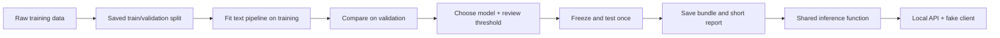

# Banking query triage: learning plan

**Status:** roadmap; training and API implementation are still ahead.

## Goal

- English banking message → one of 77 intents → simulated route or review.
- Local, CPU-friendly, easy to explain, modify, and demonstrate.
- Later: fake API client, hosted LLM, small local language model.
- No real banking actions. Priorities: clear behavior and honest limitations.

## Data snapshot

| Input | Rows | Intents | Examples/intent |
| --- | ---: | ---: | ---: |
| `data/raw/train.csv` | 10,003 | 77 | 35–187 |
| `data/raw/test.csv` | 3,080 | 77 | 40 |

- Columns: `text`, `category`; allowed labels: `categories.json`.
- Example: “I am still waiting on my card?” → `card_arrival`.
- Quick checks found overlapping text forms and ambiguous labels; inspect briefly.
- Strong cleaning can collapse useful distinctions. Keep raw files unchanged.
- Equal-intent test performance is a benchmark, not a production traffic estimate.

## Workflow



| Step | Smallest useful implementation |
| --- | --- |
| Load/check | `load_data()`: columns, empty text, labels, obvious duplicates/conflicts |
| Split | `make_splits()`: approximately 80/20, seed 42, preserve class representation; keep duplicate groups together |
| Build | `build_pipeline(config)`: conservative cleaning → vectorizer → classifier |
| Fit/compare | `run_experiment(config)`: same saved split for every candidate |
| Evaluate | `evaluate_model()`: accuracy, macro F1, per-intent report, fit time |
| Review policy | `apply_review_policy()`: suggested route when score passes a global threshold; otherwise review |
| Inspect | Review 10–20 errors/review cases; record a few reasons and one next experiment |
| Select | Pick manually from validation results; prefer simplicity when quality is close |
| Confirm/save | Test the frozen candidate; `save_bundle()` / `load_bundle()` |
| Reuse | Promote selected behavior into `src/`; notebooks and API call the same code |

**Evaluation boundaries**

- Learn vocabulary/TF-IDF statistics from training only, inside the fitted pipeline.
- Keep supplied test out of model, feature, threshold, and prompt selection.
- Start with one validation split; add cross-validation only if a close decision warrants it.
- Regularization controls initial linear models; early stopping is estimator-dependent.
- Keep the first demo model trained on its training portion; refitting later changes the artifact.

## Small experiment menu

| Candidate | Question |
| --- | --- |
| Most-frequent dummy | What does a trivial reference achieve? |
| Word TF-IDF + logistic regression | Is a simple probability-output model sufficient? |
| Word TF-IDF + linear SVM | Does another linear classifier improve useful errors? |
| Optional counts vs TF-IDF | Does weighting help with the same classifier? |
| Optional character features | Do spelling errors justify another feature type? |

- If needed: `C ∈ {0.1, 1, 10}`; word ngrams `(1, 1)` vs `(1, 2)`.
- Small, hypothesis-driven comparisons; no exhaustive combination sweep.

## Review threshold

For probability outputs: `route if max_probability >= threshold; else review`.

- Coverage = routed / all.
- Accepted accuracy = correct routed / routed; unavailable when routed = 0.
- Review rate = reviewed / all.
- Compare a few illustrative thresholds, e.g. `0.5, 0.7, 0.9`, on validation.
- SVM margins are not probabilities: calibrate within training if a probability policy is needed.
- High confidence can still be wrong, especially for unsupported text.

## Outputs and tests

- Per run: fitted pipeline, resolved configuration, seed/split/data identifiers, metrics.
- Selected bundle also includes threshold, score type, labels, and environment versions.
- Final report: comparison table, chosen run, short reasons, weaknesses, next improvement.
- Unit tests: input checks, split separation, leakage boundary, review behavior.
- Integration: fit tiny fixture → save/load → predict; later add an API request.
- On promotion to `src/`, check predictions still match the selected notebook behavior.

## Fake application

```text
client → POST /predict {"text": "Where is my card?"}
       → shared inference → {intent, score, score_type, action, model_version}
```

- First a function/script; then a thin HTTP wrapper, e.g. FastAPI.
- Load the model once at startup; return explicit input/service errors.
- Try: clear query, typo, ambiguous question, unrelated topic, two requests, empty text.
- Docker is available for API execution and integration tests.
- Add mounts/volumes only when useful for sharing datasets, models, or outputs.

## Later LLM experiments

- Start with standalone classification; try fallback on review cases only if useful.
- Same evaluation splits; compare quality, review rate, latency, cost, and failed calls.
- Prompt = task + allowed labels + optional descriptions/training examples + output schema.
- Version prompts/model/settings; tune on development data, never test.
- Separate user text from instructions; validate output labels and structure.
- Bounded retries/timeouts; invalid output → review/error.
- LLM self-reported confidence is not a calibrated probability; scores may be absent.
- Fine-tuning, retrieval, and agent frameworks wait for an actual need.

## Start here

1. Baseline notebook: saved split + dummy + TF-IDF/logistic regression.
2. Focused comparison + review threshold + short selection report.
3. Reusable code + saved bundle + unit/integration tests.
4. Fake API/client; Docker where helpful.
5. Hosted/local LLM comparison + prompt engineering.

[Repository locations](repository_guide.md) · [Working preferences](../AGENTS.md)
